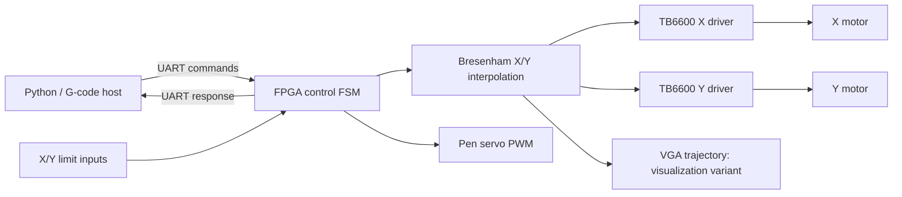
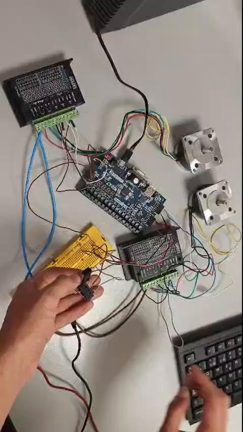
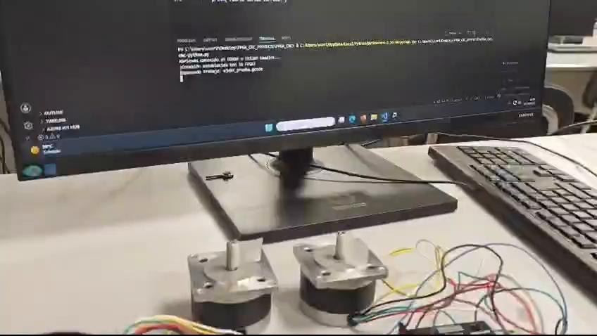
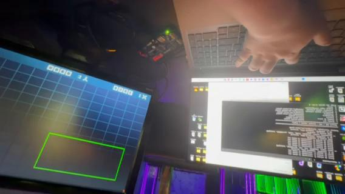

# FPGA CNC Controller — Basys3, VHDL & Vivado

**[Español](README_ES.md) · [Demos](media/README.md) · [Version comparison](docs/VERSION_COMPARISON.md) · [Validation](docs/VALIDATION.md)**

An academic FPGA project exploring coordinated two-axis motion for a CNC pen plotter. A Python host interprets a subset of G-code and sends movement commands over UART; the Basys3 FPGA performs Bresenham interpolation, step/direction generation, pen-servo control and limit-input handling.

The repository contains **two complementary demonstrations**, preserved as independent projects:

| Variant | Purpose | Start here |
|---|---|---|
| **Hardware + homing** | Connect external drivers, motors, servo and limit switches to observe physical motor movement and homing. | [`variants/hardware-homing`](variants/hardware-homing) |
| **VGA trajectory simulation** | Display the simulated trajectory of synchronized X/Y motion on a VGA monitor. Includes a sequence-aware UART protocol and virtual homing for demonstrations. | [`variants/vga-simulation`](variants/vga-simulation) |

“VGA simulation” describes the demonstration's purpose: it runs on the FPGA and visualizes commanded steps. It is not a desktop-only simulator or measured motor-position feedback. **Virtual homing only changes the G28 behavior; it does not disable motor outputs for other moves.**

## Project at a glance

- **FPGA:** Digilent Basys3, Artix-7 `xc7a35tcpg236-1`.
- **RTL / tools:** VHDL, AMD/Xilinx Vivado; project preparation checked with Vivado 2025.2.
- **Host:** Python 3 + `pyserial`, UART **115200 baud, 8N1**.
- **Motion:** two-dimensional Bresenham interpolation, separate X/Y TB6600 axis drivers.
- **Peripherals:** SG90/MG90S-style pen servo, X/Y limit inputs; VGA output in the visualization variant.
- **Learning focus:** hardware/software interfaces, finite-state machines, coordinated pulse generation, serial protocols and FPGA peripheral integration.



## Watch the demonstrations

| Hardware setup | Physical motors | VGA trajectory |
|---|---|---|
| [](media/demo-01.mp4) | [](media/demo-02.mp4) | [](media/demo-03.mp4) |
| [Video · 6 s](media/demo-01.mp4) | [Video · 23 s](media/demo-02.mp4) | [Video · 33 s](media/demo-03.mp4) |

The original videos are included unchanged. Their exact bitstream revisions are not recorded. GitHub may offer a download instead of inline MP4 playback. The original [project poster](media/project-poster.jpg) is also included; use the source and this documentation for current interfaces and validation status.

## Repository layout

```text
variants/
  hardware-homing/       Original physical-peripheral demonstration
  vga-simulation/        Original rapido_es_v3 VGA demonstration
scripts/                Portable Vivado project creation
docs/                   Comparison, source hashes and validation notes
media/                  Three videos, preview frames and original poster
```

All **64 original source/project/example/document files** from the two folders are retained byte for byte. Generated Vivado runs, caches, checkpoints and simulator outputs are excluded. Fourteen matching files are intentionally kept in both variants so that each remains self-contained; the two host/RTL protocols must not be mixed. See the [detailed comparison](docs/VERSION_COMPARISON.md).

## Recreate a Vivado project

Run these commands from a cloned repository using a terminal with Vivado on `PATH`:

```powershell
vivado -mode batch -source scripts/create_project.tcl -tclargs hardware-homing
# OR
vivado -mode batch -source scripts/create_project.tcl -tclargs vga-simulation
```

Open `build/<variant>/FPGA_CNC.xpr` in Vivado, then run synthesis, implementation and Generate Bitstream. The helper imports each variant's RTL, XDC and original testbenches and sets `top_level` as the design top. It does not synthesize or program hardware. Existing testbench limitations are documented below.

The supplied `.xpr` files inside each variant are preserved as originals; they can contain paths/cache references from the development machine. The helper recreates projects using local paths after cloning. Pin assignments are in each variant's `FPGA_CNC.srcs/constrs_1/imports/Tutorial/Basys3_Master.xdc`.

The VGA variant also includes its original non-project build script:

```powershell
cd variants/vga-simulation
vivado -mode batch -source build_bitstream.tcl
```

That script writes `build/rapido_es_v3/top_level_cnc_rapido_es_v3.bit`. Program the matching bitstream with Vivado Hardware Manager. Rebuilding and hardware programming were not performed as part of this repository publication.

## Run the hardware demonstration

1. Build and program the **hardware-homing** design.
2. Connect peripherals according to that variant's XDC and the actual driver electrical requirements. Confirm shared ground, motor direction and limit-switch behavior before homing.
3. In `variants/hardware-homing/cnc-python.py`, set `PUERTO_SERIAL` to the correct port (original default: `COM8`) and calibrate `PASOS_POR_MM` (original assumption: 20).
4. Start the interactive menu:

```powershell
py -3 -m pip install -r requirements.txt
cd variants/hardware-homing
py -3 cnc-python.py
```

The original menu provides motor, servo and circle demonstrations plus physical homing. It expects a single-byte `K` completion response. The homing request allows up to 60,000 negative steps per axis; working limit inputs and correct directions matter. This is an educational prototype with the original host limitations retained, not a finished CNC controller.

## Run the VGA demonstration

Build/program the **vga-simulation** design, attach a VGA monitor and use its matching Python client. Replace `COM14` with the board's serial port:

```powershell
py -3 -m pip install -r requirements.txt
cd variants/vga-simulation
py -3 cnc-python.py --port COM14 --link-test 100
py -3 cnc-python.py --port COM14 --homing virtual --servo-settle 0 rectangulo_vga_rapido.gcode
py -3 cnc-python.py --port COM14 --homing virtual --servo-settle 0 triangulo_vga_rapido.gcode
```

The drawing pipeline remains active on the FPGA. For a display-only demonstration, leave the external motor power disconnected. This variant also exposes physical homing, but the demonstration here is the VGA trace.

The VGA client supports linear G0/G1 moves, G28, G90/G91 and pen up/down via Z. Feed-rate F and arc commands G2/G3 are not implemented. `--motor-hz` estimates host timeouts; it does **not** reconfigure the FPGA clock. The configured 3000 Hz versus the hardware variant's 1000 Hz is a parameter difference, not a measured overall performance benchmark.

## Validation and known limitations

- The VGA client's three existing offline protocol tests passed (lost completion reply, checksum-error retry, stale sequence response).
- All nine VGA design RTL files passed Vivado's VHDL-2008 parsing check.
- Full simulation has **not** passed: `tb_fsm_main.vhd` uses the reserved word `sequence` as a parameter; the top-level testbench still expects the older reply format. These original test files are retained for traceability.
- No new synthesis, timing closure, hardware programming or mechanical accuracy measurement is claimed by this publication.
- The hardware host can advance its internal position after a serial timeout, and changing the pen state introduces an extra X step. Completion acknowledgments are not physical position measurements. Review the [validation notes](docs/VALIDATION.md) before extending the prototype.

The poster records the original classroom presentation, including its historical validation claims; it is not a fresh test report. Its “9-bit frame” label should be read against the actual implementation: **9-byte application commands over 8N1 UART**.

## Provenance

Prepared for a personal engineering portfolio from the supplied `FPGA_CNC - homing` and `FPGA_CNC_rapido_es_v3` folders. Original code and Spanish notes are preserved; English/Spanish navigation, comparison notes, media previews and a project-creation helper were added. No new license grant or claim of exclusive authorship is introduced.
